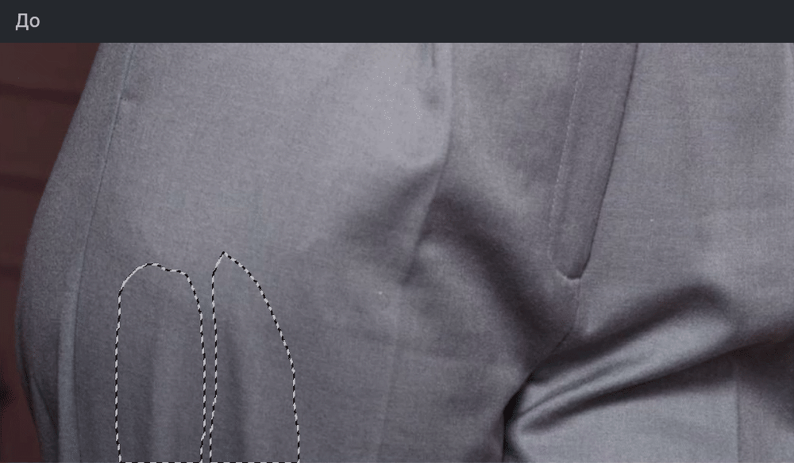
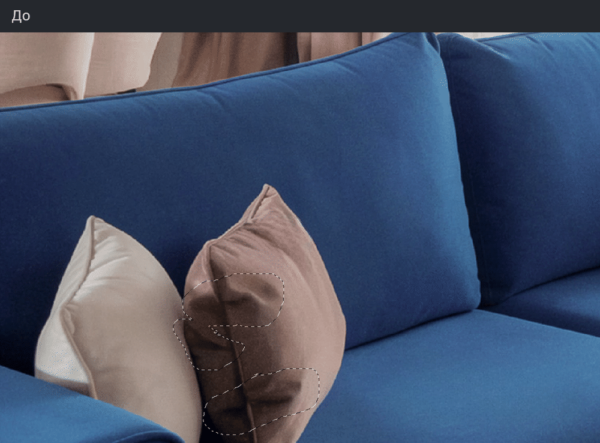
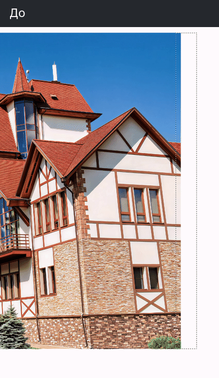
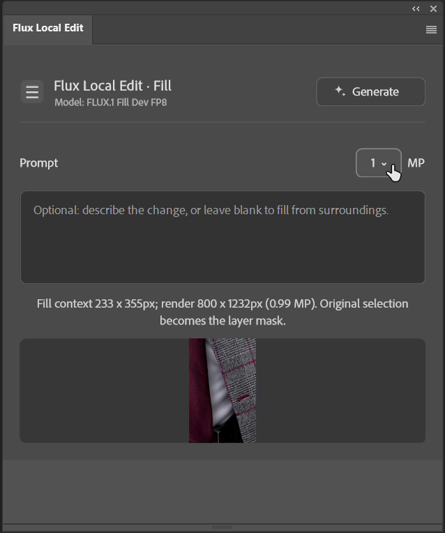

# Flux Local Edit

Локальная генеративная ретушь в Photoshop. Выделите участок, выберите Fill или Edit и получите результат на новом слое через ComfyUI.

**[Скачать плагин 0.1.6 (.ccx)](https://github.com/kuznetsovphotographer-prog/Flux-Local-Edit/releases/download/v0.1.6/com.local.photoshop.flux-local-edit_PS.ccx)** · **[Установка с нуля](https://kuznetsovphotographer-prog.github.io/Flux-Local-Edit/docs/installation.html)** · **[Посмотреть демонстрации](https://kuznetsovphotographer-prog.github.io/Flux-Local-Edit/)**

Кнопка скачивания выше ведёт прямо к установочному CCX. [На странице релиза](https://github.com/kuznetsovphotographer-prog/Flux-Local-Edit/releases/tag/v0.1.6) он находится в разделе Assets. Чтобы скачать исходники вместе с инструкциями и демонстрациями, выберите там Source code (zip). HTML-презентацию можно открыть по ссылке выше или из скачанной папки `docs/index.html` без установки дополнительных программ.

## Поправьте фотографию там, где нужно

Лампа мешает в кадре, на ткани появилась складка, хочется достроить край фотографии? Сделайте выделение привычными инструментами Photoshop. Плагин отправит изображение в локальный ComfyUI и вернёт сгенерированный участок обратно в документ. Копировать файлы между программами для каждой правки не нужно.

### Fill: выделение произвольной формы

FLUX.1 Fill Dev FP8 получает участок фотографии с окружением и маску выделения. Подходит для заполнения, удаления деталей, правок ткани и достраивания подготовленного края холста. Лассо, растушёвка и несколько раздельных областей поддерживаются. Результат приходит одним новым слоем с маской исходного выделения.

### Edit: правка по описанию

FLUX.2 Klein 9B FP8 меняет прямоугольный участок по текстовой инструкции. Можно подключить Reference. В версии 0.1.6 Edit требует сплошного прямоугольного выделения; для лассо используйте Fill.

## Ещё примеры Fill

| Складки на одежде | Подушка в интерьере |
| --- | --- |
|  |  |

Все примеры взяты из реальных записей работы. GIF переключаются между кадрами до/после. В HTML доступны короткие видео процесса: ожидание генерации вырезано, скорость оставшихся фрагментов не ускорена. Это отдельные удачные примеры, а не гарантия результата на любой фотографии. Цветокоррекция в демонстрационные материалы не добавлялась.

## Что понадобится

- Windows и Photoshop **25.0 (2024) или новее**. Рабочая проверка автора: portable Photoshop 27.8. Другие portable-сборки не гарантируются. macOS не тестировалась.
- Локальный ComfyUI на **http://127.0.0.1:8188**.
- Модели для выбранного режима. Их нет внутри CCX, ссылки и точные папки есть в инструкции.
- Видеокарта и оперативная память, достаточные для моделей. Универсального проверенного минимума VRAM у этого релиза нет; первый тест проводите на 1 MP.

Панель не использует платный API и не требует ключа для генерации. При указанном localhost-адресе изображения обрабатываются вашим ComfyUI на компьютере. Это не заменяет лицензии Photoshop и моделей.

## Начните с установки, а не с JSON

1. [Установите панель в Photoshop](docs/INSTALLATION_RU.md#photoshop).
2. [Запустите ComfyUI](docs/INSTALLATION_RU.md#comfyui).
3. [Скачайте модели Fill и/или Edit](docs/INSTALLATION_RU.md#models).
4. Сделайте небольшое выделение, выберите режим и нажмите Generate.

**Workflow JSON не является плагином.** UXP Developer Tool принимает `plugin/manifest.json`, а обычная установка использует CCX. ComfyUI получает готовый граф от плагина автоматически. Открывать шаблон в браузере перед каждой генерацией не нужно.

## Возможности версии 0.1.6

Посмотреть панель в Photoshop

- Два режима с видимым названием активной модели.
- Независимые тексты запросов для Fill и Edit.
- Выбор 1–4 MP. Это размер генерации, а не всего PSD и не обещание увеличения детализации.
- Новый слой вместо изменения исходного слоя.
- Reference в Edit; файл хранится только в текущей сессии панели.
- Stop во время генерации.
- Запись Edit и Fill в Photoshop Actions для двух функциональных горячих клавиш. Ограничения записи описаны в [инструкции](docs/INSTALLATION_RU.md#actions).

## Чего не стоит ожидать

Пустой запрос Fill не означает команду "удали". Модель достраивает содержимое по окружению и иногда добавляет лишнее. Для управляемой правки напишите, что должно быть на месте выделения. Возможны сдвиг оттенка, швы и изменения деталей; иногда нужны повторная генерация, маска, кривые или уровни. Плагин не заявляет качество, идентичное Adobe Firefly или другим моделям.

Смена пункта Fill/Edit сама по себе не загружает и не выгружает модели. Следующий Generate запускает соответствующий граф; видеопамятью управляет ComfyUI.

## Лицензии и авторство

Автор плагина: Александр Кузнецов. Независимый проект, не официальный продукт Adobe или Black Forest Labs.

FLUX.1 Fill Dev и используемая здесь FLUX.2 Klein **9B** распространяются с non-commercial лицензиями. Условия использования весов и условия использования результатов различаются. Не считайте наличие бесплатной загрузки разрешением на любую коммерческую работу: проверьте [лицензию Fill](https://huggingface.co/black-forest-labs/FLUX.1-Fill-dev/blob/main/LICENSE.md), [лицензию Klein 9B](https://huggingface.co/black-forest-labs/FLUX.2-klein-9b-fp8/blob/main/LICENSE.md) и [условия коммерческого лицензирования BFL](https://bfl.ai/licensing). Это справочная информация, не юридическая консультация.

Лицензия на исходный код плагина пока отдельно не назначена автором. Публикация исходников сама по себе не означает MIT/Apache. Веса моделей не входят в репозиторий.

## Для автора и разработчиков

Исходники в `plugin/`. Тесты: `node plugin/tests/run-tests.js`.

- [Описание релиза](RELEASE_NOTES_v0.1.6.md)
- [Полная инструкция](docs/INSTALLATION_RU.md)
- [Установка в проверенную portable-сборку](docs/PORTABLE_RU.md)

Проверка презентации: `node maintenance/test_comparisons.cjs`. Проверка файлов комплекта: `python maintenance/check_package.py`. Для пересборки HTML-инструкций используется `maintenance/build_guides.mjs` и пакет `marked`.

Если что-то не работает, укажите версию Photoshop, способ установки, выбранный режим и полный текст ошибки. Не прикладывайте клиентские фотографии или журналы с личными данными без необходимости.
