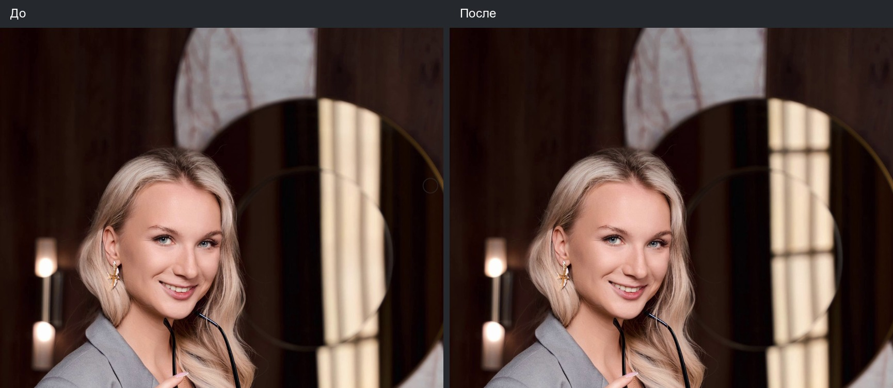
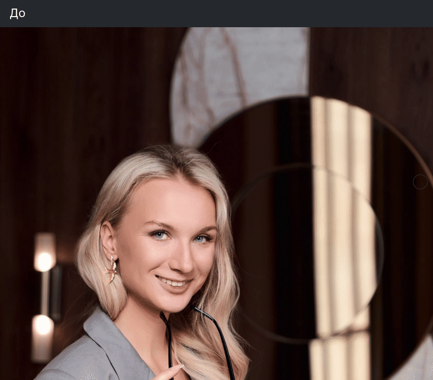
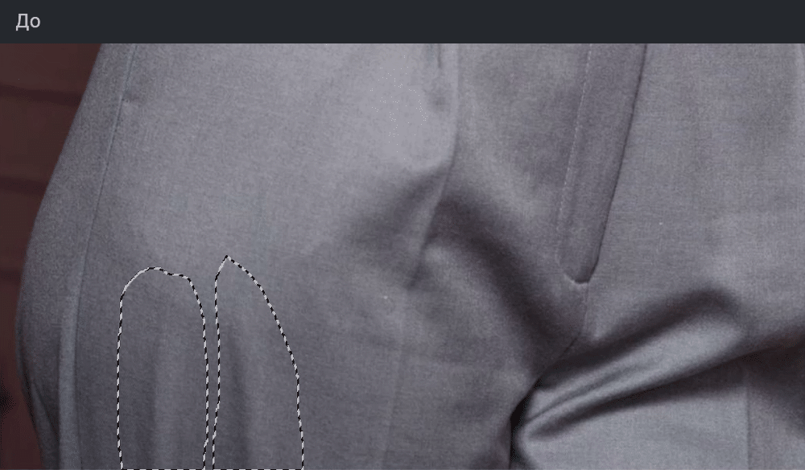
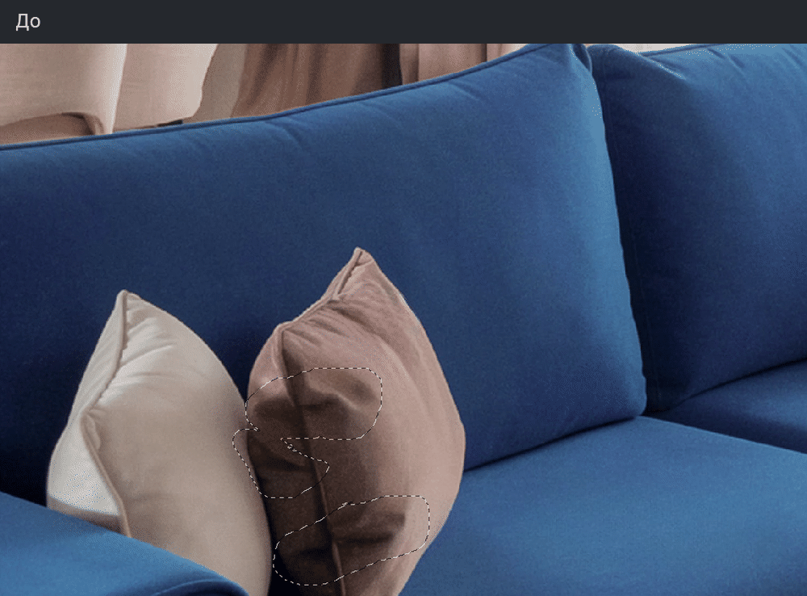
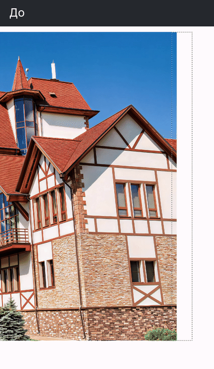
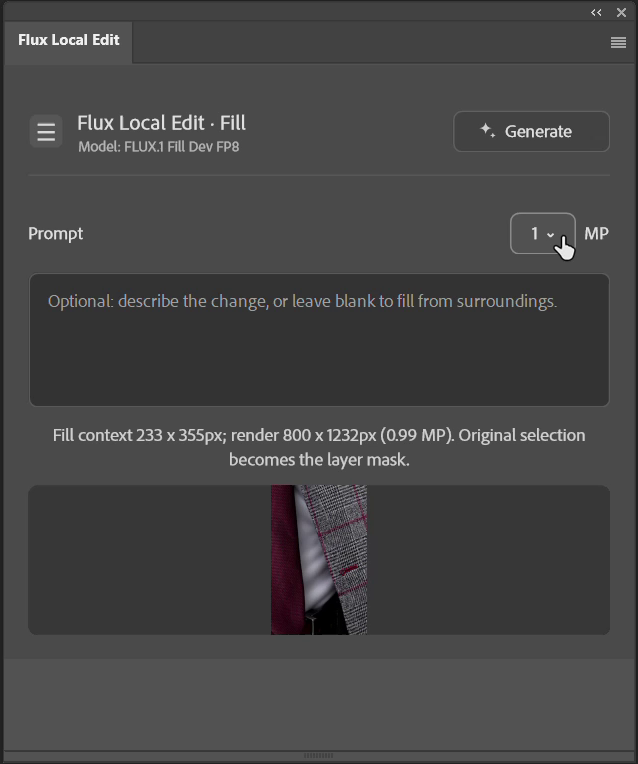

# Local Edit для Photoshop

Выделите участок в Photoshop и отправьте его в свой ComfyUI. Local Edit вернёт правку на новом слое. В панели три модели: FLUX.1 Fill, FLUX.2 Klein и Qwen Image 2.1 Turbo.

**[Скачать Local Edit 0.4.0](https://github.com/kuznetsovphotographer-prog/Flux-Local-Edit/releases/tag/v0.4.0)** · **[Как установить](docs/INSTALLATION_0.4.0_RU.md)** · **[Посмотреть демонстрации](https://kuznetsovphotographer-prog.github.io/Flux-Local-Edit/)**

Для обычной установки скачайте CCX 0.4.0 и, если нужны, Windows-скрипты из раздела Assets. Исходники той же версии лежат в ветке `main`: их можно загрузить через `plugin/manifest.json` в UXP Developer Tool. [Предыдущий релиз 0.2.2](https://github.com/kuznetsovphotographer-prog/Flux-Local-Edit/releases/tag/v0.2.2) остаётся доступен.

## Что изменилось в 0.4.0

- **FLUX.1 Fill** берёт больше окружения и смягчает стык. У узкого лассо маска генерации расширяется меньше, чтобы не захватывать соседний материал. У нескольких областей переход идёт только внутрь каждого выделения.
- **FLUX.2 Klein** и **Qwen Image 2.1 Turbo** вклеивают правку по точной исходной маске, без автоматической растушёвки. Оба принимают до двух референсов. Qwen работает в 8 шагов, без улучшателя промпта.
- ComfyUI можно запустить вручную либо настроить автозапуск для Windows. В панели есть отдельные кнопки прогрева модели и освобождения VRAM.

## Несколько участков за один запуск

Все три режима обрабатывают раздельные выделения по очереди. Плагин вставляет готовый слой перед тем, как отправить следующий фрагмент. Все результаты оказываются в одной группе, исходные слои остаются на месте.

1. Выделите первый участок, затем с зажатым **Shift** добавьте остальные.
2. Для **Edit / Klein** используйте прямоугольники с **Feather 0**. **Fill** и **Qwen** принимают также лассо.
3. Оставляйте зазор между областями: соприкасающиеся выделения объединяются.
4. Задайте общий запрос и начните с **1 MP**. Выбранные MP относятся к каждому фрагменту отдельно.
5. Нажмите Generate. Счётчик покажет текущий участок и число готовых результатов.

Все фрагменты берутся из одной сохранённой копии фотографии. Предыдущая генерация не попадает в следующий запрос. Порядок обработки: сверху вниз, при одинаковой верхней границе слева направо. При Stop или ошибке готовые слои сохраняются.

Для удаления можно задать явный запрос, например `Remove the object and reconstruct the background naturally.` Пустой запрос в Fill просит продолжить окружение; результат зависит от кадра. В Klein и Qwen до двух референсов используются для всей очереди. [Подробная инструкция 0.4.0](docs/INSTALLATION_0.4.0_RU.md).

## Поправьте фотографию там, где нужно

Лампа мешает в кадре, на ткани появилась складка, хочется достроить край фотографии? Сделайте выделение привычными инструментами Photoshop. Плагин отправит изображение в локальный ComfyUI и вернёт сгенерированный участок обратно в документ. Копировать файлы между программами для каждой правки не нужно.

### Fill: выделение произвольной формы

FLUX.1 Fill Dev FP8 получает участок фотографии с окружением и маску выделения. Подходит для заполнения, удаления деталей, правок ткани и достраивания подготовленного края холста. Лассо, растушёвка и несколько раздельных областей поддерживаются. Каждый раздельный участок получает отдельный запрос и отдельный слой со своей маской. Слои собираются в группу.

### Edit: правка по описанию

FLUX.2 Klein 9B FP8 меняет прямоугольный участок по описанию. Можно подключить до двух референсов. Для правки произвольной области по тексту также есть Qwen Edit.

## Ещё примеры Fill

| Складки на одежде | Подушка в интерьере |
| --- | --- |
|  |  |

Все примеры взяты из реальных записей работы. GIF переключаются между кадрами до/после. В HTML доступны короткие видео процесса: ожидание генерации вырезано, скорость оставшихся фрагментов не ускорена. Это отдельные удачные примеры, а не гарантия результата на любой фотографии. Цветокоррекция в демонстрационные материалы не добавлялась.

## Что понадобится

- Windows и Photoshop **25.0 (2024) или новее**. Рабочая проверка автора: portable Photoshop 27.8. Другие portable-сборки не гарантируются. macOS не тестировалась.
- Локальный ComfyUI на **http://127.0.0.1:8188**.
- Модели для выбранного режима. Их нет внутри CCX, ссылки и точные папки есть в инструкции.
- Видеокарта и оперативная память, достаточные для моделей. Универсального проверенного минимума VRAM у этого релиза нет; первый тест проводите на 1 MP.

Панель не использует платный API и не требует ключа для генерации. При указанном localhost-адресе изображения обрабатываются вашим ComfyUI на компьютере. Это не заменяет лицензии Photoshop и моделей.

## Начните с установки, а не с JSON

1. [Установите панель 0.4.0 в Photoshop](docs/INSTALLATION_0.4.0_RU.md).
2. [Установите и запустите ComfyUI](docs/INSTALLATION_RU.md#comfyui), если его ещё нет.
3. [Скачайте модели для нужного режима](docs/INSTALLATION_0.4.0_RU.md#модели).
4. Сделайте небольшое выделение, выберите режим и нажмите Generate.

**Workflow JSON не является плагином.** UXP Developer Tool принимает `plugin/manifest.json`, а обычная установка использует CCX. ComfyUI получает готовый граф от плагина автоматически. Открывать шаблон в браузере перед каждой генерацией не нужно.

## Возможности версии 0.2.2

Посмотреть панель в Photoshop

- Два режима с видимым названием активной модели.
- Независимые тексты запросов для Fill и Edit.
- Выбор 1–4 MP. Это размер генерации, а не всего PSD и не обещание увеличения детализации.
- Новый слой вместо изменения исходного слоя.
- Последовательная очередь участков в обоих режимах и общая группа результатов.
- Reference в Edit; файл хранится только в текущей сессии панели.
- Stop во время генерации.
- Запись Edit и Fill в Photoshop Actions для двух функциональных горячих клавиш. Ограничения записи описаны в [инструкции](docs/INSTALLATION_RU.md#actions).

## Чего не стоит ожидать

Пустой запрос Fill не означает команду "удали". Модель достраивает содержимое по окружению и иногда добавляет лишнее. Для управляемой правки напишите, что должно быть на месте выделения. Возможны сдвиг оттенка, швы и изменения деталей; иногда нужны повторная генерация, маска, кривые или уровни. Плагин не заявляет качество, идентичное Adobe Firefly или другим моделям.

Смена режима сама по себе не загружает и не выгружает модели. Следующий Generate запускает выбранный граф. Кнопка освобождения VRAM выгружает все модели из памяти общего ComfyUI, если очередь пуста, но не выключает сервер.

## Лицензии и авторство

Автор плагина: Александр Кузнецов. Независимый проект, не официальный продукт Adobe или Black Forest Labs.

FLUX.1 Fill Dev и используемая здесь FLUX.2 Klein **9B** распространяются с non-commercial лицензиями. Условия использования весов и условия использования результатов различаются. Не считайте наличие бесплатной загрузки разрешением на любую коммерческую работу: проверьте [лицензию Fill](https://huggingface.co/black-forest-labs/FLUX.1-Fill-dev/blob/main/LICENSE.md), [лицензию Klein 9B](https://huggingface.co/black-forest-labs/FLUX.2-klein-9b-fp8/blob/main/LICENSE.md) и [условия коммерческого лицензирования BFL](https://bfl.ai/licensing). Это справочная информация, не юридическая консультация.

Лицензия на весь исходный код плагина пока отдельно не назначена автором. Для компонентов, адаптированных из OpenFill, сохранена [лицензия Apache 2.0](plugin/OPENFILL-LICENSE.txt). Веса моделей не входят в репозиторий.

## Для автора и разработчиков

Исходники в `plugin/`. Автотесты: `run-tests.js`, `batch-tests.js`, `fill-blend-tests.cjs` и `engine-tests.cjs` в папке `plugin/tests/`.

- [Изменения в 0.4.0](RELEASE_NOTES_v0.4.0.md)
- [Установка Local Edit 0.4.0](docs/INSTALLATION_0.4.0_RU.md)
- [Инструкция для CCX 0.2.2](docs/INSTALLATION_RU.md)
- [Установка в проверенную portable-сборку](docs/PORTABLE_RU.md)

Проверка презентации: `node maintenance/test_comparisons.cjs`. Проверка файлов комплекта: `python maintenance/check_package.py`. Для пересборки HTML-инструкций используется `maintenance/build_guides.mjs` и пакет `marked`.

Если что-то не работает, укажите версию Photoshop, способ установки, выбранный режим и полный текст ошибки. Не прикладывайте клиентские фотографии или журналы с личными данными без необходимости.
